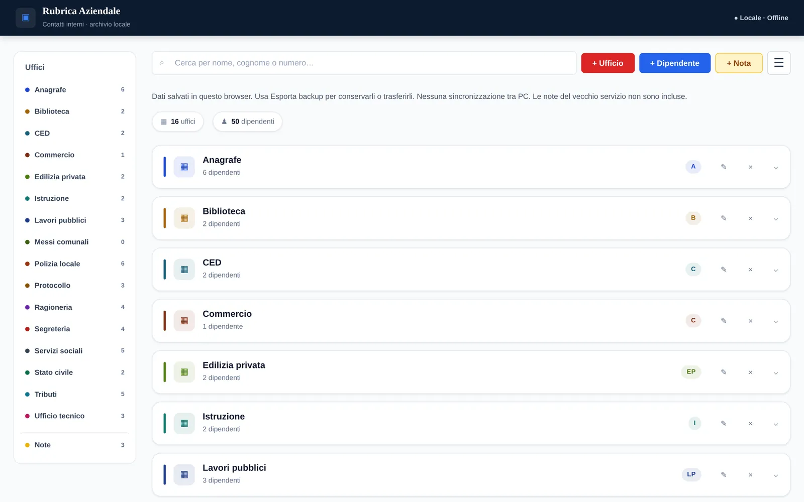
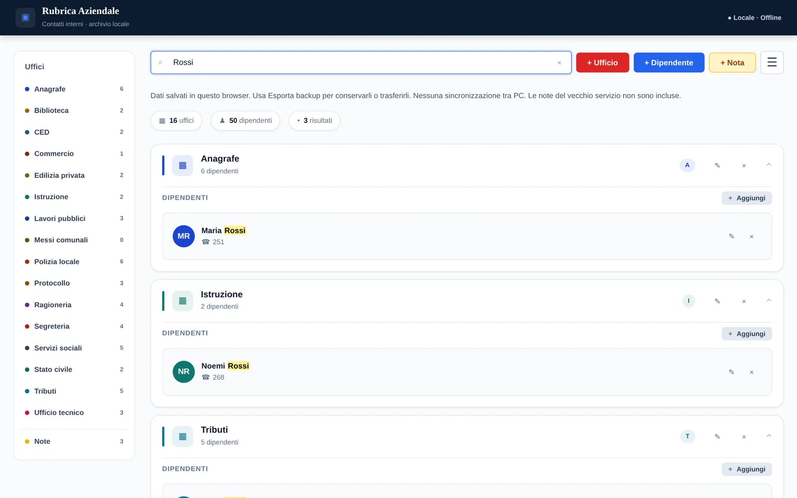
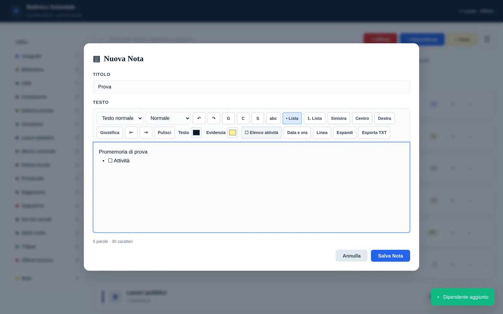

# Rubrica uffici e dipendenti

Interni e contatti degli uffici in una pagina sola, con ricerca, note, stampa e backup, anche senza rete.

> **Versione pubblica ripulita.** Codice, dati di prova, schermate e descrizioni sono stati controllati e ripuliti da dati sensibili: nomi, indirizzi, account, matricole, recapiti e credenziali sono inventati, e non ci sono riferimenti interni reali. Lo stemma dell'ente non è incluso.

| | |
|---|---|
| Categoria | Organizzazione |
| Contesto | Stage del 4° anno al Comune di Verolanuova |
| Stato | Realizzato durante lo stage |
| Tecnologie | HTML, JavaScript |
| Demo | Inclusa, con dati inventati |

## Dal caos all'ordine

**Prima:** Numeri interni sparsi fra elenchi stampati, fogli e promemoria.

**Dopo:** Una rubrica per uffici con ricerca, note e backup.

## Contesto

In un ente con molti uffici, trovare l'interno giusto o la persona di riferimento è un'operazione di tutti i giorni.

## Il problema

Gli elenchi stampati invecchiano in fretta e le note utili finiscono su fogli che si perdono.

## La soluzione

Una pagina HTML autonoma che funziona senza Internet: uffici, dipendenti e note con un piccolo editor. I dati restano nel browser e si conservano con un backup.

## Come funziona

1. Uffici
2. Dipendenti
3. Ricerca
4. Note
5. Stampa e backup

## Funzioni principali

- Uffici e dipendenti con interni e numeri
- Ricerca per nome, cognome o numero
- Note con grassetto, corsivo, elenchi, checklist, data e ora
- Note esportabili in TXT
- Stampa e PDF dell'intera rubrica
- Backup ed esportazione dei nomi
- Nessun server e nessuna connessione necessari

## Casi inclusi nella demo

- 16 uffici e 50 dipendenti inventati, un ufficio vuoto
- Omonimi in uffici diversi e un nome lunghissimo
- Persone senza telefono, con due interni o con un numero esterno
- Un backup per tornare ai dati di prova

## Privacy

- I dati restano nel browser del computer.
- Nella demo uffici, nomi e numeri sono inventati.

## Limiti

- Ogni browser ha la sua copia dei dati: non è un database condiviso.
- Non prevede un accesso con password.

## Schermate

Schermate della versione dimostrativa, con dati inventati.

_Uffici, dipendenti e note in una pagina._

_Ricerca: gli omonimi compaiono nei rispettivi uffici._

_Editor delle note, con elenco di attività._

## Provarlo

Apri `Rubrica_Locale.html` in un browser. Per tornare ai dati di prova usa il ripristino con `Backup_dati_di_prova.json`.

La demo pronta da scaricare, in un unico ZIP, è nella cartella [`demo/`](demo/).

**Verificato:** Apertura, ricerca, aggiunta di ufficio, dipendente e nota, salvataggio nel browser e ritorno ai dati di prova con il backup, in Chrome su Linux.

---

Parte del [portfolio dei progetti di stage](https://github.com/Shad272/portfolio) di Angelo Erik Scontrino.
